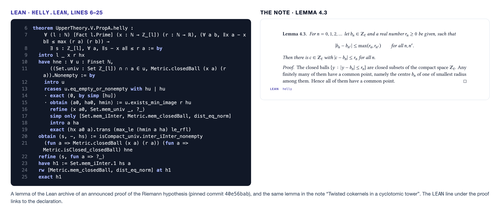
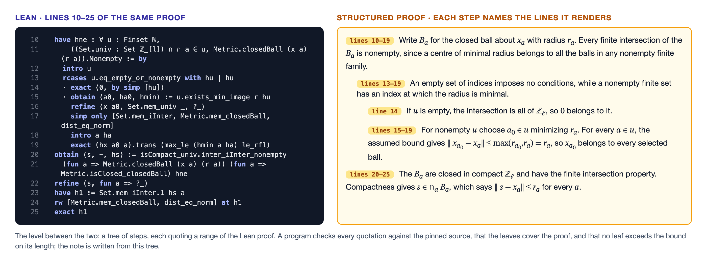
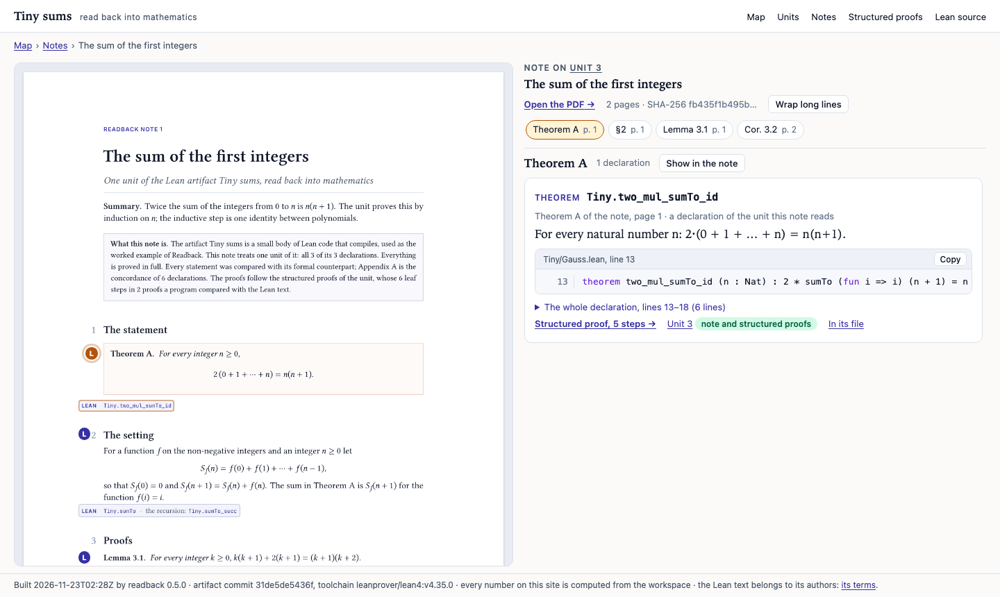
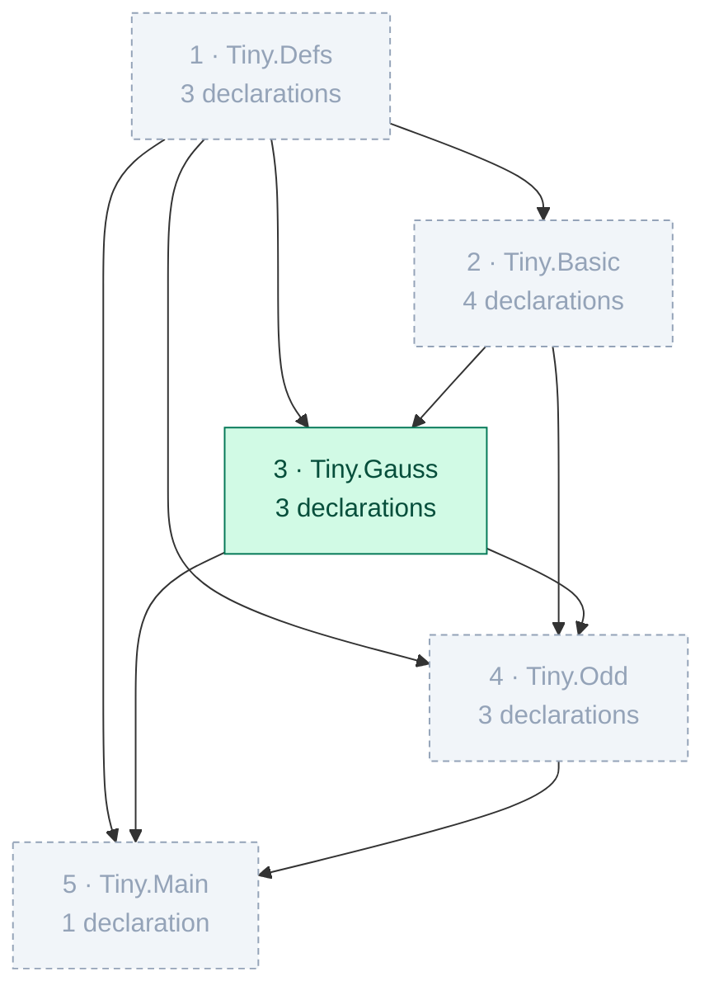

<div align="center">

# Readback

**Read a compiled Lean development back into mathematics people can read.<br>
Every sentence is tied to the Lean lines it renders, and a program checks every tie.**

[](https://github.com/nasqret/readback/actions/workflows/selftest.yml)


[](LICENSE)


[Quick start](#quick-start) · [How it works](#how-it-works) · [What is checked](#what-is-checked) ·
[Results](#results-on-a-large-artifact) · [Example](#a-worked-example) · [Status](#status) · [Install](INSTALL.md)

</div>

> In aviation a pilot *reads back* a clearance and the controller confirms it. Here two agents read a formal
> proof back into mathematics, a program confirms every tie to the formal text, and the round trip (formalizing
> again from the reading alone) is the last confirmation.

A Lean proof that compiles has been checked by a kernel, not read by a person. Readback is a skill for two AI
agents that turns such an artifact into a **map** of its chapters, **structured proofs** whose steps quote the Lean
lines they render, and **typeset notes** in standard mathematical language, each statement linked to its
declaration.



## At a glance

| | Readback |
|---|---|
| **You give** | a Lean 4 project that compiles, and the name of its root module |
| **You get** | a map of units (chapters) · structured proofs · typeset notes with a concordance · a reading site · a book *(experimental)* · a record of every exchange |
| **Agents** | a **reader** in Codex and a **writer** in Claude Code, talking through a mailbox in the workspace |
| **Checked by program** | quotations byte for byte · coverage of every proof · size of every leaf step · types of intermediate facts · scope of references · notation · the signature rule |
| **Runs on** | Python 3.9+ with the standard library; LuaLaTeX and `latexmk` for notes; poppler for page images; the artifact's own Lean toolchain only for `--lean-ranges` |
| **Licence** | [0BSD](LICENSE) |

## Quick start

```bash
git clone https://github.com/nasqret/readback && cd readback
make selftest        # the whole chain on the example, in a temporary directory
make install         # the skill, and the commands readback-claude and readback-codex
```

Put the Lean sources in a folder `src/`, go to the folder above it, and start the two agents, each in its own
terminal:

```bash
readback-claude      # the writer: Claude Code, effort xhigh
readback-codex       # the reader: Codex, effort max
```

The first command makes the workspace `ws/` beside `src/` (census, unit proposal, status, a git repository) and
finds the root module when the imports leave no doubt. Each command starts its client in the workspace with an
effort and a first prompt, and the second installs the reader's skill for Codex when it is missing. Run the same
commands later to continue. `--print` shows what would be started without starting it. The clients use their own
default models unless you name one: in `~/.config/readback/agents.json` for every new workspace, in a workspace's
`readback.json` for that workspace, or with `--model` for one session. [INSTALL.md](INSTALL.md) has the details
and a first test with two fresh agents.

## How it works

<picture>
  <source media="(prefers-color-scheme: dark)" srcset="docs/how-it-works-dark.png">
  
</picture>

Readback never goes from Lean straight to prose. Between the two stands a **structured proof**:

1. **Lean → structured proof.** The reader turns every formal proof into a tree of small steps. Each step says in
   words what it establishes and quotes the range of Lean lines it renders; the leaves cover the proof, and no
   leaf quotes more than 8 lines.
2. **The check.** `rb.py check UNIT` compares the tree with the pinned source and refuses a dossier that fails.
3. **Structured proof → mathematics.** The writer reads the checked steps and writes the note: one idea per
   paragraph, complete proofs or an explicit "taken for granted", and a concordance from every statement to its
   declaration.

The English of a step can still be wrong, but it is pinned to the few lines it claims to render, so a reviewer
checks it against at most eight lines instead of a file.



## What is checked

| Check | What it guarantees | Command |
|---|---|---|
| Quotations | every Lean line a step or a statement quotes is the line of the pinned source, byte for byte | `rb.py check UNIT` |
| Coverage and grain | every part of a proof belongs to exactly one step; no leaf is longer than the bound (8 lines) | `rb.py check UNIT` |
| Typed facts and references | every `have` with a written type gets its own step, whose stated fact is that type exactly; a step cites only what is in scope | `rb.py check UNIT` |
| Units | every member of a unit is treated in its dossier or listed as out of scope | `rb.py check UNIT` |
| Exact ranges *(optional)* | statement and value boundaries recovered by Lean itself, in a built project | `rb.py check UNIT --lean-ranges` |
| The signature rule | every argument of every declaration is accounted for, in Lean's order; a defined function is written with one slot per explicit argument; every hypothesis stands in its statement or in a numbered Setting it cites | census, `rb.py check`, `rb.py note` |
| The gate itself | after each clean build the signature gate runs on copies of the note broken on purpose; the build fails if it misses one | `rb.py note SLUG` |
| Notes | citations resolve; every symbol is in the notation list; a unit counts as read only when a built note covers its members | `rb.py note SLUG`, `rb.py status` |
| Sources | a change of the Lean sources since the census is reported, and a unit whose declarations changed no longer counts as read | `rb.py status` |

**Not checked by program:** whether the English of a step is right, and whether a note's proof is a correct
proof. These rest on the writer's reading and on review. The round trip below is how they are measured.

## Results on a large artifact

The method was built on the Lean archive released with L. Alpöge's announced proof of the Riemann hypothesis
(20 November 2026). The announcement is a claim, and nothing here asserts that the hypothesis is proved; the work
reads the formal text.

| | |
|---|---|
| **Archive** | 175,187 Lean modules · 17.4 million lines · 818,755 theorems and lemmas |
| **Published notes** | 3 notes · 57 pages · 177 Lean declarations in their concordances: [*Twisted cokernels in a cyclotomic tower*](https://nasqret.github.io/riemann-rev/digests/tower-bound.pdf) (31 pp.) · [*Local nilpotence over a cyclotomic tower*](https://nasqret.github.io/riemann-rev/digests/local-nilpotence.pdf) (10 pp.) · [*Descent to a layer of the cyclotomic tower*](https://nasqret.github.io/riemann-rev/digests/layer-descent.pdf) (16 pp.) |
| **Blind round trip** | the 16 lettered statements of the three notes, each written in Lean by a fresh session that saw only the note's text and a glossary of definitions, then compared with the archive in Lean: 7 equivalent in both directions (2 of them definitionally), 4 in one direction, 4 unproved, 1 translation refuted by a counterexample |
| **What it showed** | the relation each note declares to the archive was confirmed in 9 of 16; no statement of a note was shown wrong; most misses trace to definitions missing from the glossary, which came from the notes' concordances |
| **Where to look** | the structured proofs on the [proof atlas](https://nasqret.github.io/riemann-proof-atlas/); the notes, the guide and the map on [riemann-rev](https://nasqret.github.io/riemann-rev/) |

These notes were made with the project-specific predecessors of `rb.py`, which generalizes them. The round trip
was run by the reading agent of that project with its own tools; Readback does not ship a round-trip tool yet.

## A worked example

[`examples/tiny-lean`](examples/tiny-lean) is a Lean 4 project with no dependencies: 7 modules, 104 lines, 16
declarations, ending in `Tiny.main` (the sum of the first *n* odd numbers is *n*², and Gauss's sum).
[`examples/tiny-sample`](examples/tiny-sample) holds what Readback makes of one of its units:

| Level | File |
|---|---|
| map and status | [`STATUS.md`](examples/tiny-sample/STATUS.md), [`MAP.md`](examples/tiny-sample/MAP.md) |
| structured proofs | [`units/3/proofs/`](examples/tiny-sample/units/3/proofs): 2 proofs, 8 steps, 6 leaves, each quoting its lines |
| note | [`notes/gauss/gauss.pdf`](examples/tiny-sample/notes/gauss/gauss.pdf): 3 pages, a concordance of 6 declarations |
| site | `make example-site` builds it under `build/tiny-site/` |

On the reading site, a mark on a note's page or a `LEAN` line opens the declarations behind it: the reading in
words, the Lean statement with its line numbers, the whole declaration, and the structured proof when there is one.



The map of the example after one unit is read (an arrow runs from a unit to a unit that uses it; green: note and
structured proofs; grey: not read yet):



The sample dossier was written by hand for the self-test. The other four units are left grey on purpose: they
are the first test for a fresh pair of agents ([INSTALL.md](INSTALL.md), "The first test").

## Two agents, on purpose

| | Reader | Writer |
|---|---|---|
| Runs in | Codex | Claude Code |
| Suggested effort | **max** | **xhigh** |
| Makes | what the root theorems really use · units · dossiers · structured proofs | the review of every dossier · the notes · the map and the site · the book · coordination |
| Owns | `reading/` | `notes/`, `book/` |
| Skill | [`skills/readback-reader`](skills/readback-reader/SKILL.md) | [`skills/readback`](skills/readback/SKILL.md) |

They talk through a mailbox in the workspace: one directory per message, an evidence label on every claim
(`kernel-verified`, `verified` with the command, `computed-once`, `heuristic`). Neither takes the other's word: the
writer runs the check over every dossier before reading it. A message is a peer's request; publishing, pushing and
budgets stay with you.

## How a session goes

1. **Open.** The census says what the artifact is: size, `sorry`, axioms, the cone of the root.
2. **Units.** The reader turns the proposal into the ledger of chapters; the writer reviews it (`rb.py ledger`).
3. **A dossier.** The reader writes statements in words and structured proofs, checks itself, and hands off.
4. **The check.** `rb.py check UNIT`; each step gets a source range and a digest in `check.json`.
5. **A note.** The writer reads the structured proofs and writes the mathematics; `rb.py note SLUG` builds it.
6. **The map.** `rb.py status` and `rb.py site`: one more unit turns from grey to green.
7. **Repeat** along one thread of the proof, top down; then assemble the book.

## Status

| Part | State |
|---|---|
| workspace, census, unit proposal | ✅ self-tested |
| the two start commands (`readback-claude`, `readback-codex`) | ✅ self-tested up to the command that starts the client |
| mailbox between the agents (`rb.py mail`) | ✅ self-tested; in daily use on the large case |
| check of the ledger of units (`rb.py ledger`) | ✅ self-tested |
| check of dossiers: statements, quotations, grain, coverage, typed facts, scope | ✅ self-tested, including failing cases |
| note builder: concordance, citations, notation, reader index | ✅ self-tested |
| the signature rule in the census, the dossier check and the note build | ✅ self-tested, including notes broken on purpose; used to repair the three notes of the large case |
| repair of older notes (`note --account`, `--rewrite`, `--check`, a shared notation table) | ✅ self-tested; used once, on three notes in parallel |
| status and map with greyed entries | ✅ self-tested |
| census of declarations, `sorry` and `axiom` | ✅ reads the text, not Lean's parser; `sorry` and `axiom` counts are lower bounds |
| reading site (`rb.py site`) | ✅ self-tested; checked by eye in Chrome on a wide window |
| book assembly | 🟡 experimental; the summary is hand-written |
| round trip: formalize again from the reading, compare in Lean | 🟡 measured once on statements (above), with the large case's own tools; no tool in this repository yet ([design](skills/readback/references/roundtrip.md)) |
| the atlas: declarations placed on a map of the literature | ⬜ not in this repository ([the atlas of the large case](https://nasqret.github.io/riemann-proof-atlas/)) |
| a whole artifact read with two fresh agents | 🟡 once, with version 0.3, on an artifact of 1,318 lines (8 units, 26 structured proofs, 8 notes); a second run on another artifact stopped after the first of its 14 units; not yet repeated with this version |

## Principles

- Say what is claimed and what is checked; "it compiles" is not "we have read it".
- Every number is computed, never typed.
- Quotation ties the levels: a step carries its Lean lines, a note carries a concordance.
- A program check is not a reading; both happen, and each note says which is which.
- Standard mathematical language; every symbol defined; complete proofs or an explicit "taken for granted".
- The signature rule: a defined function keeps every argument of its Lean definition everywhere, and every
  hypothesis of a theorem stands inside its statement.
- Start from the final statement, take inputs for granted, dig where you care; unread parts stay grey with their
  true sizes.
- Publishing, pushing and budgets need the owner's word.

## Layout

```
skills/readback/            the writer's skill: SKILL.md, references/, scripts/rb.py, assets/ (templates)
skills/readback-reader/     the reader's skill
examples/tiny-lean/         a small Lean artifact
examples/tiny-sample/       what Readback makes of one unit of it
tests/selftest.py           the chain end to end, and every rule the tools enforce
tests/test_validation.py    the dossier check in detail; with READBACK_TEST_LEAN=1 also against Lean
INSTALL.md                  installation, models and effort, the first test with two agents
```

## Roadmap

1. A round-trip tool: sealed statements, re-formalization from the note alone, comparison in Lean, and a check
   that every definition a statement uses is named in its glossary.
2. The atlas for any artifact: the declarations on a map of the literature, with an explorer and a chapter panel.
3. The reader's tooling: a kernel export of what the root uses; dossiers at scale.
4. The book at scale: a guide to the chapters generated from the map.
5. A run with two fresh agents on this version, on a mid-size artifact.

## Citing

If you use Readback, please cite it with the metadata in [CITATION.cff](CITATION.cff).

## Licence

[0BSD](LICENSE): use, copy, modify and distribute for any purpose, with or without fee.
